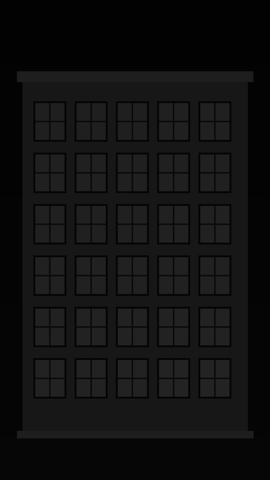

# urban-rhythm-mask

城市光亮节奏蒙版剪辑技能。GitHub 账号：**a148325128-max**。

把建筑窗格、分层屋檐、摩天轮座舱、同心方框、斑马线等规则结构，剪成暗底上逐拍亮起的视频。



它使用同一张图片的暗底与原色亮层，通过独立蒙版控制局部点亮：

`画面 = 暗底 + alpha × (原色 − 暗底)`

支持逐个或成组点亮、累积保留、行列轮换、带孔方框和整幅恢复。输出 MP4、独立灰度蒙版、标定图及可修改的 JSON 时间轴。面向静态图像，不包含移动镜头的自动跟踪。

## 安装与使用

需要 Python 3、FFmpeg 和 ffprobe。Python 依赖见 `requirements.txt`。

```bash
git clone https://github.com/a148325128-max/urban-rhythm-mask.git
cd urban-rhythm-mask
python3 -m venv .venv
source .venv/bin/activate
python3 -m pip install -r requirements.txt
```

把仓库中的 `SKILL.md`、`agents/`、`scripts/`、`references/` 放入你的技能目录下的 `urban-rhythm-mask/`。例如 Codex 使用 `~/.codex/skills/urban-rhythm-mask/`。也可直接运行 Python 脚本。

先跑不依赖外部图片与音乐的示例：

```bash
python3 scripts/create_demo.py --output-dir outputs/demo
python3 scripts/render_rhythm_masks.py \
  --config outputs/demo/timeline.json \
  --output outputs/demo/demo.mp4 \
  --qa-dir outputs/demo/masks
```

实际项目可对 AI 助手说：

> 使用 $urban-rhythm-mask，把这组建筑图片做成逐拍点亮的视频。按照实际窗格和屋檐分区，保留蒙版与节拍配置，不要旁白，画面文字只放仓库名和 GitHub 账号名。

先固定源图与裁切，重新标定每个单元，再排节拍。换建筑不能直接套旧坐标。[完整配置说明](references/timeline-schema.md)包含灰度 alpha、空心框、事件起止与音轨参数。

```bash
python3 scripts/render_rhythm_masks.py \
  --config path/to/timeline.json \
  --size 720x1280 --stills 0,0.8,1.5 \
  --qa-dir outputs/check
```

时间采用输出时间轴的秒数；事件首次出现会对齐到下一帧。镜头切换和名称图层等后处理，建议用整数帧界限同步。

## 验证与案例

已在 macOS 上实际验证示例及长沙建筑案例；其他系统尚未实测。长沙建筑案例使用 118 个独立蒙版，涵盖钟楼透视窗格、重檐和阶梯式塔楼立面，通用渲染器没有因换建筑而重写。参见[案例方法](references/changsha-case.md)。

生成的文件会自动核对尺寸、帧数、时长和音轨，并记录输入图片 SHA-256。还应查看输出视频的实际解码帧，检查边缘、漏亮和节奏；技术检查不等于审美验收。

仓库不附第三方参考视频、参考照片或音乐。示例图形由随附代码绘制，不需要 API Key。`audio` 参数可使用你自己的音乐；不填写即输出无声视频。

视频里需要展示项目时，使用仓库名 **urban-rhythm-mask** 和GitHub 账号 **a148325128-max** 即可。
